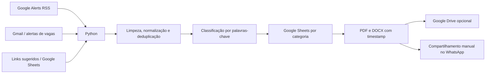

# Arquitetura — SidWorks TI

O projeto original automatizava parte do fluxo de seleção e preparação de oportunidades de TI para divulgação manual via WhatsApp.

## Modos de uso

- `python main.py --demo`: offline, com dados fictícios em `examples/`, sem Google ou encurtadores; gera PDF e DOCX com nomes fixos.
- `python main.py`: fluxo real; requer credenciais próprias, planilha Google de teste, feeds configurados e pode modificar abas. Gera PDF e DOCX nomeados com a data e hora de execução.

## Segurança e limitações

- OAuth JSON local armazenado sob `creds/` ignorado pelo Git.
- O programa real usa encurtadores públicos para URLs; não forneça URLs privadas ou confidenciais, pois seriam enviadas a terceiros.
- O upload ao Drive é opcional, depende do escopo OAuth e das permissões da pasta configurada.
- A integração Google não foi validada de ponta a ponta com uma configuração nova na versão pública.
